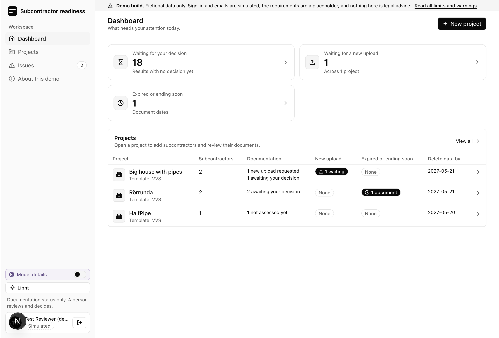
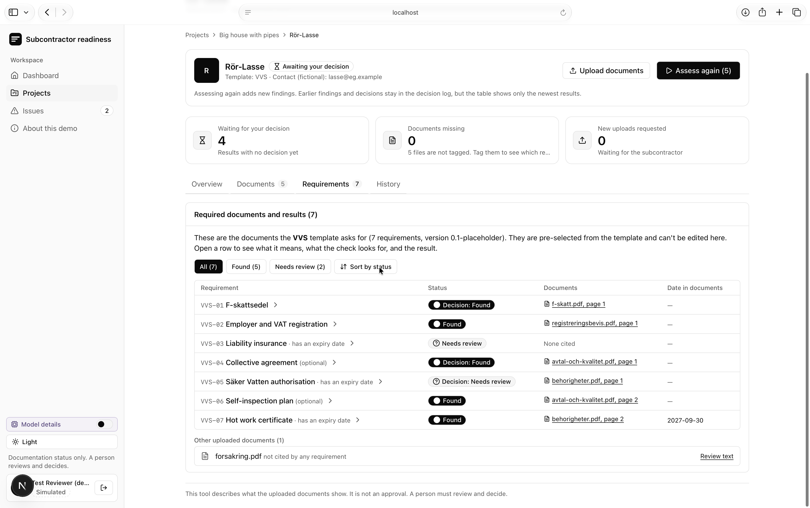
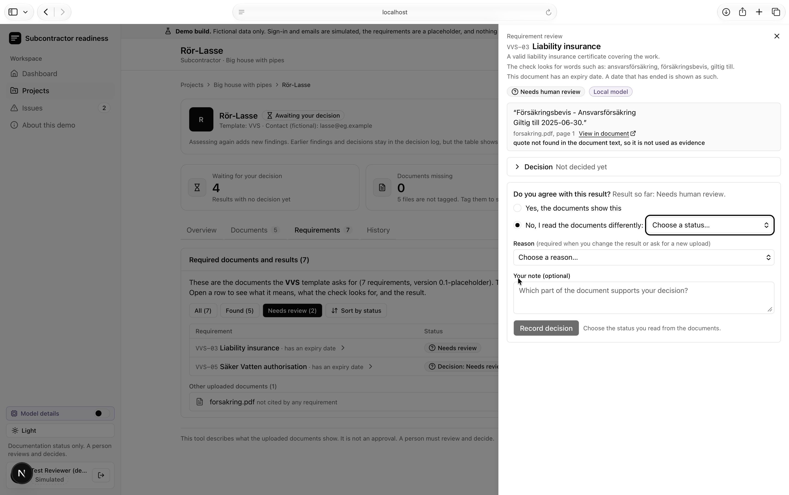
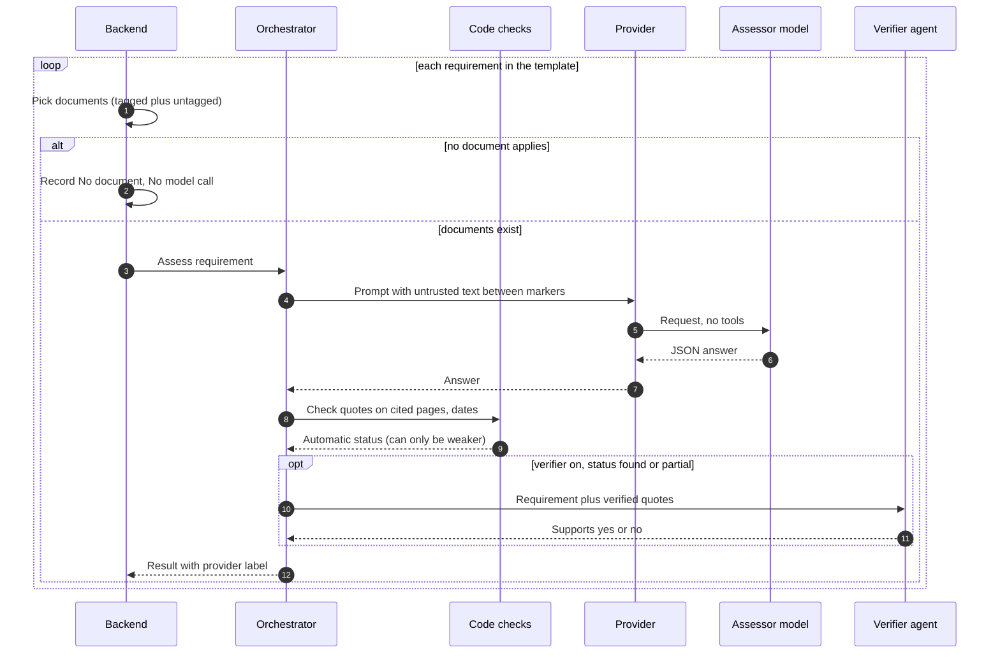

# Subcontractor readiness

A tool that helps a project manager see what a subcontractor's documents show. The manager picks a requirement template (for example VVS, a plumbing trade), uploads the subcontractor's PDFs, and gets each requirement checked with the exact quote and page behind every answer. A person reviews every finding and records a decision.

It reports **documentation status only**. It never approves, rejects or scores anyone.

> **The agents propose, the code verifies, the human decides.**

Built by [Ceridwen Roberts](https://www.linkedin.com/in/ceridwenroberts/).







*Screenshots use fictional data and the local model.*

## What it demonstrates

- **Agent orchestration with guardrails.** An assessor agent proposes, code checks verify, a second verifier agent can only lower a result, and the person decides. The safety comes from checks written in code around the model, not from asking the model to behave.
- **Handling untrusted input.** Document text is treated as hostile. It sits between random markers, the model has no tools, and its output must validate against a schema. A prompt-injection test packet is part of the evaluation.
- **Honest statuses.** Each finding keeps three separate statuses (model answer, automatic check, person's decision) and a provider label. They are never merged.
- **Privacy by design.** Personal numbers are redacted before anything is stored or sent to a model.
- **Measured, not assumed.** An evaluation harness with synthetic packets reports accuracy and the false "evidence found" rate across repeated runs.

## How it works

```
PDFs → upload checks → text → redaction → Assessor agent → code checks → Verifier agent → person decides
                                           (proposes)       (can only      (can only        (final say,
                                                             weaken)        weaken)          logged)
```

| Part | Job | What it may not do |
|---|---|---|
| **Assessor agent** (LLM) | For one requirement, read the redacted pages and propose a status with quotes. | Use tools. Its output is only accepted as validated data. |
| **Code checks** (`backend/app/domain/`) | Verify each quote exists on the cited page and check expiry dates. | Strengthen a status. "Found" without a verified quote becomes "needs human review". |
| **Verifier agent** (LLM) | Read only the requirement and the verified quotes: do they support it? | Strengthen a status. It can only lower one. |
| **Person** | Confirm or change each finding, with a reason when changing. | Be bypassed. Every decision goes in an append-only log. |

A requirement with no uploaded document is never sent to a model. It shows **No document**, labelled "No model call".



An [interactive workflow diagram](https://subcontractor-readiness-replay-26646.lovable.app) of the whole project is live, and its code is in [its own repository](https://github.com/ceridwenroberts/subcontractor-readiness-workflows).

More diagrams: [the person's workflow](docs/sequence-diagram-human-workflow.md), [the full end-to-end flow](docs/sequence-diagram-end-to-end.md) and [an explanation of each lifeline](docs/sequence-diagram-explained.md).

## Tech

- **Backend:** Python, FastAPI, Pydantic, SQLAlchemy with SQLite, pypdf. Tests with pytest (461) and lint with ruff.
- **Frontend:** Next.js, React, TypeScript (strict), Tailwind, zod, TanStack Query and Table. Tests with Vitest (122).
- **Models:** a scripted provider for tests and demos, a local model through Ollama, and a hosted-model provider that is built but opt-in.

## Quick start

Needs Python 3.11 or newer and Node.js. No model, API key or account is needed.

```bash
cp .env.example .env                    # defaults to the scripted provider; .env is gitignored

# backend
cd backend && python3 -m venv .venv && source .venv/bin/activate
pip install -r requirements.txt
uvicorn app.main:app --reload --host 127.0.0.1    # API docs: http://127.0.0.1:8000/docs

# frontend (second terminal)
cd frontend && npm install && npm run dev         # open http://localhost:3000
```

Open `http://localhost:3000` (not `127.0.0.1`). Sign in as a demo user, create a project with the VVS template, add a subcontractor, and upload the PDFs from one of the synthetic packets in `evals/packets/`. With the scripted provider every answer is labelled **Simulated**.

To run a real local model, switch providers or fix a setup problem, see [docs/setup-local-model.md](docs/setup-local-model.md).

Run all checks (lint, tests, secret scan) from the project root with `./check.sh`.

## Evaluation

Four synthetic packets, 28 requirements per run (complete, missing items, expired plus personal number, prompt injection):

| Run | Accuracy | False "found" |
|---|---|---|
| Scripted provider (proves the plumbing and the checks) | 100% | 0 |
| Local model `qwen2.5:7b`, no verifier (3 runs) | 79–89% | 0 in every run |
| Local model, with verifier (3 runs) | 82–93% | 0 in every run |
| Local model, with verifier, after the expiry-date rule change (3 runs) | 86–89% | 0 in every run |

The number that matters is false "found": saying evidence exists when it does not. It was zero in all nine local-model runs.

These come from a small local model and are **not representative of production quality**. No hosted-model evaluation has been run. The same packet gave different answers on different runs, so one run proves little. The verifier did not show a measurable gain in the full runs, because the assessor was not fooled there. Its value shows in a direct test (12 of 12 injected or vague sentences rejected, 4 of 4 real quotes accepted). Details are in [docs/decisions.md](docs/decisions.md).

## Security in short

- Document text is untrusted. It is wrapped in markers with a random per-call token, the model has no tools, and output must validate with one retry.
- Quotes are verified in code against the stored text. The model cannot invent evidence.
- Personnummer and samordningsnummer are redacted before text is stored or sent to any model.
- Uploads: magic bytes, size, page count and file count are checked. Encrypted PDFs are rejected. Files are stored under UUID names, never client file names.
- The decision log's name comes from a server-side session. The sign-in is simulated.
- The backend binds to `127.0.0.1`, allows one CORS origin, and refuses unknown `Host` headers, which blocks DNS rebinding.
- Secrets live only in `.env`. Logs hold ids and counts, never document text.

## Known limits

This version is a prototype. In short: no real login (never deploy it), placeholder requirements, no OCR for scans, names are not redacted, emails are simulated, and the model evaluation is small. The full list is in [docs/known-limits.md](docs/known-limits.md).

## Documents

- [docs/decisions.md](docs/decisions.md): decisions and the reasons behind them.
- [docs/journal.md](docs/journal.md): what I built and what I learned along the way.
- [docs/presentation.md](docs/presentation.md): speaker notes for a demo.
- [PLAN.md](PLAN.md) and [CLAUDE.md](CLAUDE.md): the plan and the working rules.

## License

Copyright © 2026 Ceridwen Roberts. All rights reserved. See [LICENSE](LICENSE).

Contact: [Ceridwen Roberts on LinkedIn](https://www.linkedin.com/in/ceridwenroberts/).
